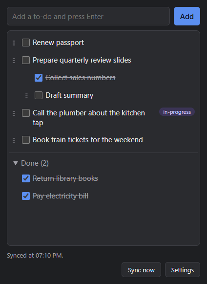

# Trilium Reminder

A small desktop window that puts your [Trilium Notes](https://github.com/TriliumNext/Trilium) to-do list in front of you every time you come back to your PC: after sign-in, after every unlock and after every resume from standby. You can add, finish and reorder items right there, and the changes go straight into your Trilium note.



> **Unofficial.** This project is not affiliated with or endorsed by the Trilium project.

## Features

- Shows one Trilium to-do list, centred and on top, until you close it with **Esc**.
- Opens after sign-in, every screen unlock (however short), and every resume from standby.
- Add, finish, reopen and reorder items with mouse or keyboard; sub-items stay with their parent.
- Keeps everything else in the note: formatting, links, sub-items, task states and other content.
- Works offline: shows the last list at once and sends your changes when Trilium is reachable.
- Never deletes anything. Finished items stay in the note until you clean them up in Trilium.
- Saves a Trilium revision of the note before its first change each day.

| System                    | Package             | Wake detection                                  |
| ------------------------- | ------------------- | ----------------------------------------------- |
| Windows 10/11, x64        | Installer (`.exe`)  | Built in                                        |
| Linux x64 (Debian/Ubuntu) | `.deb`, `.AppImage` | systemd user service (GNOME, KDE; i3 by config) |

Built for Trilium **0.107.0**, whose editor (CKEditor 49) gives every list item a stable ID.

## Install

Download the latest version from the [releases page](https://github.com/lbarbisch/Trilium_Reminder/releases).

**Windows:** run `trilium-reminder-X.Y.Z-windows-x64-setup.exe`. The builds are not code-signed, so SmartScreen may warn you: click **More info → Run anyway**. The app then starts with Windows.

**Debian / Ubuntu:**

```bash
sudo apt install ./trilium-reminder-X.Y.Z-linux-amd64.deb
```

Then open **Settings → Install wake service** in the app to get the window after unlock and standby. For i3 and other window managers, see [Linux](docs/manual/linux.md).

Details, download checks, updates and uninstalling: [Installation](docs/manual/install.md).

## Quick setup

1. In Trilium, create an unprotected **text note** with a to-do list.
2. Copy the note's ID (**Note info**, or the end of the note link).
3. Create a token under **Options → ETAPI**.
4. Enter the server address, note ID and token in the app, click **Test connection**, then **Save**.

More in [Trilium setup](docs/manual/trilium-setup.md).

## Documentation

- Manual website: <https://lbarbisch.github.io/Trilium_Reminder/>
- [Daily use](docs/manual/usage.md) · [Linux](docs/manual/linux.md) · [Troubleshooting](docs/manual/troubleshooting.md)
- [Development](docs/manual/development.md) · [Contributing](CONTRIBUTING.md) · [Changelog](CHANGELOG.md)

## Privacy and security

- The app connects **only to the Trilium server you enter**, using Trilium's ETAPI. There is no telemetry, no update check and no other network traffic.
- HTTPS is required, except for `localhost`. Redirects are refused, so the token is never sent anywhere else.
- The ETAPI token is encrypted with the system's secure storage (Windows DPAPI; KWallet or GNOME Keyring on Linux) and never shown again or written to logs.
- Stored on your PC, in `%APPDATA%\Trilium Reminder` (Windows) or `~/.config/Trilium Reminder` (Linux): the settings, a copy of the todo note for offline use, changes not yet sent, and a short log without note content or token.
- The window is sandboxed and only shows text; note HTML is never rendered.

Report security problems privately as described in [SECURITY.md](SECURITY.md).

## License

[GNU General Public License v3.0](LICENSE)
